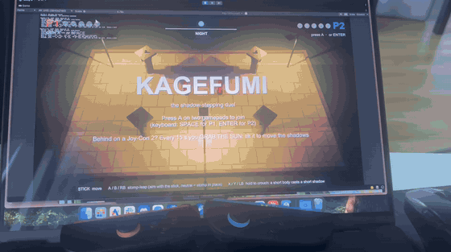

# Joy-Con 2 для Unity

Пара Joy-Con 2 от Nintendo Switch 2 — это сразу два геймпада для игры вдвоём. Один Joy-Con, повёрнутый боком, —
полноценный контроллер со стиком, кнопками и гироскопом. Этот репозиторий подключает их к играм на Unity.

- **Без консоли.** Joy-Con подключаются к компьютеру, телефону или браузеру напрямую по Bluetooth — Switch 2 не нужен.
- **На всех основных платформах.** Windows, macOS, Android, iPhone и iPad, а также в браузере: Chrome и Edge, на iPhone —
  Bluefy.
- **Как обычный геймпад.** Игре не нужно ничего знать про Joy-Con: управление, настроенное под геймпад, работает сразу.

## Что внутри

- [**Пакет `com.vivoderin.joycon2`**](Packages/com.vivoderin.joycon2/README.md) — то, что подключается к вашей игре.
  Установка и всё остальное — в его README.
- **KAGEFUMI** (`Assets/Kagefumi/`) — дуэль на двоих «наступи на тень», на которой пакет проверяется на каждой
  платформе. Она на видео выше.

---

Неофициальный проект, не связан с Nintendo. Nintendo Switch и Joy-Con — товарные знаки Nintendo.
